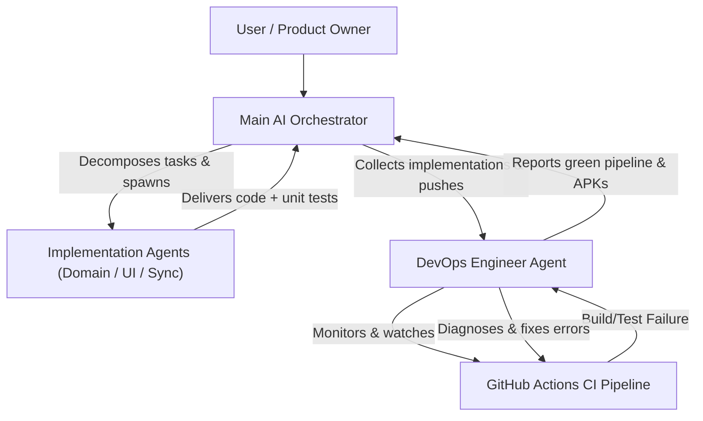

# LockerLift Multi-Agent Orchestration Skill

This skill defines how LockerLift development is executed via an **autonomous multi-agent hierarchy**. It is loaded on demand — the architectural invariants and testing mandate stay in [AGENTS.md](../../../AGENTS.md) and apply to every agent regardless of role.

---

## 1. When to Use This Skill

Load this skill when at least one of the following is true:

* The request spans more than one module (`:core:*`, `:mobile`, `:wear`).
* The work can be split into independent, parallelizable slices (e.g. domain logic + UI + sync).
* A branch has been pushed and the GitHub Actions pipeline must be watched and repaired.
* The user explicitly asks for orchestration, subagents, or a DevOps/CI loop.

Do **not** load it for single-file edits, documentation tweaks, or any task one agent can finish in a single pass — spawning subagents there only adds coordination overhead.

---

## 2. Orchestration Model

---

## 3. Agent Roles & Responsibilities

### 3.1 Main AI Orchestrator

* Acts as the primary interface to the user and overall project architect.
* Analyzes user requests, maintains architectural invariants, and decomposes goals into modular implementation tasks.
* Spawns specialized **Implementation Agents** as needed across modules (`:core:*`, `:mobile`, `:wear`).
* Collects and integrates deliverables from all implementation agents once their work is completed.
* Owns the branch, the commit history, and the pull request. Subagents never push.

### 3.2 Implementation Agents

* Autonomous subagents assigned to specific domain logic, screens, DAOs, or sync features.
* Adhere strictly to the unit testing mandate: write tests concurrently with code (`AAA` pattern).
* Report diffs, files created/modified, and test outcomes back to the Main AI Orchestrator.
* Stay inside their assigned module boundary; cross-module changes are escalated back to the orchestrator.

### 3.3 DevOps Engineer Agent

* Spawned by the Main AI Orchestrator after implementations are consolidated and pushed to the repository.
* Monitors and watches GitHub Actions CI/CD workflows (`gh run list`, `gh run watch`).
* Inspects runner logs, diagnoses build, compilation, classpath, or test failures on GitHub, and fixes them autonomously.
* Ensures the entire CI pipeline turns green and downloadable APK artifacts are produced.

---

## 4. Orchestration Procedure

### Step 1: Decompose

* Split the request into slices that map cleanly onto module boundaries.
* Prefer one slice per module over one slice per file — fewer agents, less merge friction.
* Identify the dependency order: `:core:model` → `:core:database` → `:core:sync` / `:core:healthconnect` → `:mobile` / `:wear`.
* Slices with a hard dependency between them run sequentially; independent slices run in parallel.

### Step 2: Spawn with a Handoff Contract

Every spawn message must contain:

1. **Scope:** the exact modules, packages, and files the agent may touch.
2. **Specification:** the user story / acceptance criteria being implemented.
3. **Invariants:** a pointer to [AGENTS.md](../../../AGENTS.md) — UUID primary keys, template/session decoupling, channel separation, Health Connect on phone only, foreground service on watch.
4. **Test obligation:** which unit tests must be written, following [unit-testing-guidelines](../unit-testing-guidelines/SKILL.md).
5. **Deliverable format:** files created/modified, test names, test run output, open questions.
6. **Prohibitions:** no commits, no pushes, no dependency or Gradle version changes unless explicitly assigned.

### Step 3: Collect and Integrate

* Review each deliverable against its scope before merging anything.
* Resolve cross-module conflicts in the orchestrator, not between subagents.
* Verify the combined result: run the affected module test suites once after integration, not per agent.
* Write the feature-history entry ([documentation/feature-history/](../../../documentation/feature-history/README.md)) once, centrally.

### Step 4: Commit and Push

* Follow [git-commit-guidelines](../git-commit-guidelines/SKILL.md) — Conventional Commits, atomic commits, tests in the same commit as the feature.
* Feature work goes to a dedicated branch and a draft pull request, never directly to `main`.

### Step 5: DevOps Loop

* Spawn the DevOps Engineer Agent with the branch name and the failing run ID (or "watch from now").
* The DevOps agent iterates: read logs → diagnose → fix → push → re-watch, until the pipeline is green.
* Fixes stay minimal and inside the failing scope; a fix that requires an architectural decision goes back to the orchestrator.
* Report back: pipeline status, artifact names, and any fix that changed behavior beyond the original failure.

---

## 5. Anti-Patterns

* **Spawning for trivial work.** One agent, one pass — no hierarchy needed.
* **Overlapping scopes.** Two agents editing the same file guarantees conflicts; split by module instead.
* **Subagents pushing.** Only the orchestrator pushes, so the branch history stays reviewable.
* **Skipping the integration test run.** Per-agent green tests do not prove the combined tree compiles.
* **DevOps agent refactoring.** It fixes the pipeline, it does not improve the code.
