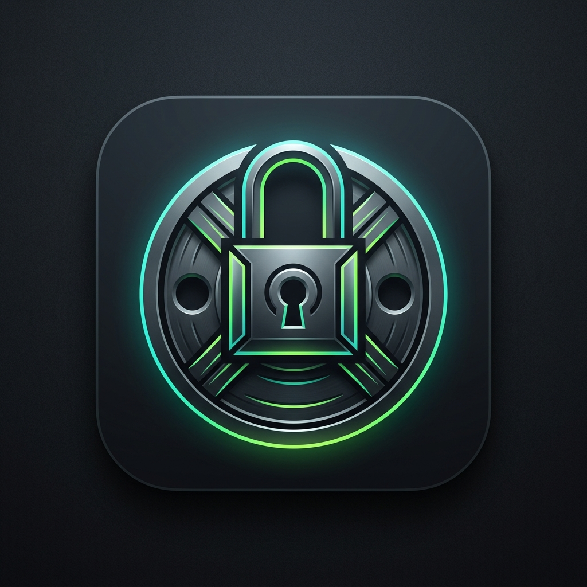

# LockerLift

<p align="center">
  
</p>

**LockerLift** is a privacy-first, open-source strength training tracker for Android and Wear OS, built for the *locker scenario*: your smartphone stays in the locker while your smartwatch tracks the entire workout completely offline.

## Key Features

**Smartphone app (`:mobile`)**
- Live workout tracking with a set table, past-performance comparison, and in-workout set editing
- Machine & exercise catalog with muscle groups, weight increments, and setup notes
- Unlimited workout templates with reordering and on-the-fly modification
- Editable workout history with cascade deletion
- Insights dashboard: training calendar, regularity, volume/exercise progression charts, and a three-class training verdict — fully configurable widget order
- Wear OS companion status, manual sync, and local backup & restore (SAF, GZip/JSON, SHA-256)
- Health Connect export and synchronized deletion
- English and German localization

**Wear OS app (`:wear`)**
- 100% autonomous tracking with zero phone connectivity required
- Rotary input for fast weight and rep adjustments
- Pause/resume, configurable rest timer with haptics, and set correction during the workout
- Store-and-forward sync queue that flushes automatically once the phone reconnects
- Progressive overload guidance based on historical performance

## The Locker Scenario

The watch operates fully autonomously during the workout — no Bluetooth, no Wi-Fi. All CRUD operations complete locally on the watch; workout records are queued and streamed to the phone asynchronously once you return to your locker (Store-and-Forward). The phone then persists the session and exports it to Health Connect. See the [Locker Scenario Guide](documentation/locker-scenario-guide.md) for details.

## Architecture

Highly modular monorepo with strict separation of concerns:

| Module | Purpose |
|---|---|
| `:core:model` | Pure Kotlin domain models, zero Android dependencies |
| `:core:database` | Room database, DAOs, SQLCipher AES-256 encryption |
| `:core:sync` | Wearable Data Layer manager, JSON serialization, sync queue worker |
| `:core:healthconnect` | Health Connect client and record builder |
| `:mobile` | Smartphone app (Jetpack Compose, Material 3) |
| `:wear` | Wear OS app (Horologist, rotary input, foreground service) |

Full system design, ER diagrams, and sync protocol: [ARCHITECTURE.md](ARCHITECTURE.md)

## Getting Started

**Prerequisites:** JDK 21, Android SDK platform `lockerlift.compileSdk` (currently 36; min SDK 28 mobile / 30 Wear OS, target SDK 35). Use the Gradle wrapper (`./gradlew`, Gradle 9.6.0). Do not install a separate Gradle binary.

```bash
# Run all unit tests
./gradlew test

# Build the smartphone and Wear OS APKs (debug and release)
./gradlew :mobile:assemble :wear:assemble
```

## Versioning

`versionName`, the phone `versionCode`, and the SDK levels live in [`gradle.properties`](gradle.properties) (`lockerlift.*`). Both app modules read those properties. Do not hardcode them in `mobile/build.gradle.kts` or `wear/build.gradle.kts`.

Phone and watch share `applicationId` `com.lockerlift` and the same `versionName`. Google Play requires a **unique `versionCode` per form factor** of one package ([Package and distribute Wear OS apps](https://developer.android.com/training/wearables/packaging)). The watch code is `lockerlift.versionCode + lockerlift.wearVersionCodeOffset` (100000). Dedicated Wear OS tracks compare codes only inside the track, and the watch manifest requires `android.hardware.type.watch`, so the higher watch code is not delivered to phones. Both sequences stay strictly increasing and cannot collide while the phone code stays below the offset. `scripts/check-version.sh` enforces that.

`compileSdk` is 36 because Health Connect 1.1.0 and AboutLibraries need it. `targetSdk` stays 35 until a deliberate behaviour-change bump. CI installs `platforms;android-<compileSdk>` from the same property (`scripts/ci-install-android-sdk.sh`).

Bump a release with the script so the gradle version, changelog, and tag stay together:

```bash
# Edit gradle.properties and prepend a CHANGELOG section (no commit, no tag)
./scripts/bump-version.sh minor

# After the changelog text is filled in, commit the two files and tag HEAD
./scripts/bump-version.sh --tag
git push origin main
git push origin vX.Y.Z   # tag push runs release.yml
```

`./scripts/bump-version.sh minor --tag` commits `gradle.properties` and `CHANGELOG.md` and tags that commit in one step. The script does not push.

`scripts/check-version.sh` fails CI when `versionName` and the top `## [X.Y.Z]` changelog entry differ, when the latest `v*` tag is newer than `versionName`, when HEAD itself is tagged with a different version, or when a tag-triggered release's tag does not match. A version that is ahead of the latest tag is allowed only while the next release is being prepared and has not been tagged yet. The release workflow runs the same check against the tag it is building.

Setup and installation instructions: [Getting Started](documentation/getting-started.md)

## Documentation

- [Documentation Portal](documentation/README.md) — user guides for mobile, Wear OS, sync, and troubleshooting
- [ARCHITECTURE.md](ARCHITECTURE.md) — technical system architecture
- [AGENTS.md](AGENTS.md) — developer and AI agent guidelines, invariants, and conventions
- [Feature Implementation History](documentation/feature-history/README.md) — chronological log of all implemented features
- [CHANGELOG.md](CHANGELOG.md) — release changelog

## License

Licensed under the [Apache License, Version 2.0](LICENSE).
